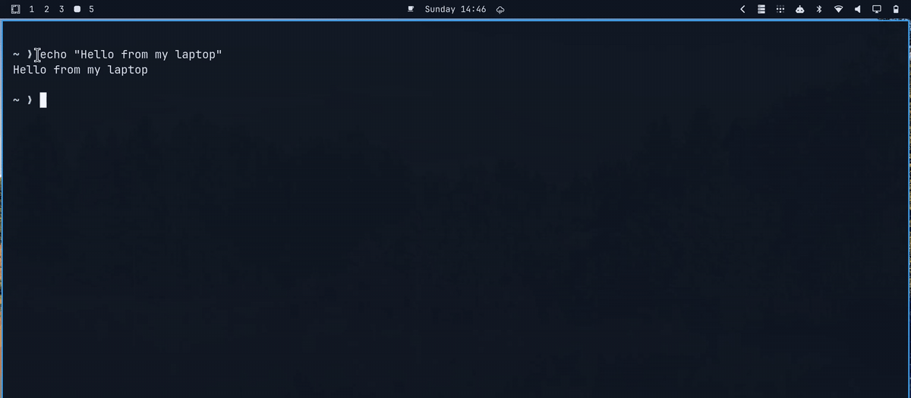

# fleetdrop

Send your clipboard or files to another one of your computers with a keypress.

<p align="center">Part of <a href="https://github.com/Frestina/fleet">Fleet</a>: fleetwatch · fleetlog · fleetdrop</p>



- **Clipboard:** copy something, press a key, pick a machine. It is now on that
  machine's clipboard. Text stays text, images stay images.
- **Files:** press another key, pick files and a machine. They land in
  `~/Downloads/fleetdrop/` there. Files you copied in a file manager are sent
  this way too.

The other machine shows a notification. Everything goes over ssh. fleetdrop is
a single bash script, with no server or background service.

> **Note:** fleetdrop has only been tested on my own setup:
> [Omarchy](https://omarchy.org) 4 (Hyprland 0.56, Arch Linux), sending between
> Omarchy machines. It is written to work on any Linux with a Wayland desktop,
> but other setups have not been tried yet. Issues and fixes are welcome.

## Setup

**1. Install**

```bash
git clone https://github.com/Frestina/fleetdrop.git
cd fleetdrop
./install.sh
```

This puts the `fleetdrop` command in `~/.local/bin`. Run `git pull` in the
folder to update it later.

**2. List your machines**

fleetdrop reads `~/.config/fleet/hosts`, the list of machines every
[Fleet](https://github.com/Frestina/fleet) tool shares. If you have another
Fleet tool, it is already there. If not, run `fleetdrop clip` once to create
it with the machine you are on. Then add a line for each other machine:

```
# label   ssh target      hostname
desktop   desktop.lan     desktop
laptop    me@192.0.2.20   my-laptop
```

- **label:** the name you pick the machine by.
- **ssh target:** what you would type after `ssh` to reach it.
- **hostname:** what `uname -n` prints on that machine. fleetdrop skips the
  line for the machine it runs on, so you can copy the same file to all of them.

The full format is in [HOSTS.md](https://github.com/Frestina/fleet/blob/main/HOSTS.md).

You must be able to `ssh` to each machine without typing a password
(`ssh-copy-id <target>` sets that up).

**3. Add keybindings**

See [Keybindings](#keybindings). fleetdrop does not add any by itself.

## Usage

```
fleetdrop clip [LABEL]            send the clipboard to LABEL
fleetdrop file [LABEL] [PATH...]  send files to LABEL
```

Leave out LABEL to pick from a menu, or PATH to pick files in a file chooser.
With only one other machine, no menu is shown.

## Keybindings

Suggested keys:

| Keys | Command |
| --- | --- |
| `SUPER + ALT + C` | `fleetdrop clip` |
| `SUPER + SHIFT + ALT + C` | `fleetdrop file` |

**Check that the keys are free before you add them.** In Hyprland, binding
keys that are already in use does not replace the old action; both run.

- Omarchy: run `omarchy menu keybindings --print` and look for `SUPER ALT + C`
  and `SUPER SHIFT ALT + C`.
- Hyprland: this prints any binding already on those keys. No output means
  they are free.

  ```bash
  hyprctl binds -j | jq '.[] | select(.key == "C" and (.modmask == 72 or .modmask == 73))'
  ```

If they are taken, pick other keys. Then add them:

**Omarchy**, in `~/.config/hypr/bindings.lua`:

```lua
o.bind("SUPER + ALT + C", "Send clipboard to machine", "fleetdrop clip")
o.bind("SUPER + SHIFT + ALT + C", "Send files to machine", "fleetdrop file")
```

**Hyprland**, in `~/.config/hypr/hyprland.conf`:

```
bindd = SUPER ALT, C, Send clipboard to machine, exec, fleetdrop clip
bindd = SUPER SHIFT ALT, C, Send files to machine, exec, fleetdrop file
```

**GNOME, KDE and others:** add a custom shortcut in the keyboard settings that
runs `fleetdrop clip` or `fleetdrop file`.

## Requirements

On every machine:

- `ssh`
- `rsync` 3.2.3 or newer
- `wl-clipboard`
- `notify-send` (from `libnotify`), for notifications

To receive a clipboard, the machine must be logged in to a Wayland desktop.

To pick machines and files from a menu, the sending machine needs one of:

- a menu: Omarchy's, `walker`, `fuzzel`, `wofi`, `rofi`, `zenity`, or `fzf` in
  a terminal
- a file chooser: Omarchy's, `zenity` or `kdialog`

`./install.sh` tells you if something is missing.

## Settings

Optional. Put them in `~/.config/fleet/drop/config.toml`:

```toml
ssh_options = "-o IdentityAgent=none"
```

`ssh_options` adds options to every ssh connection, separated by spaces. The
example above helps if your ssh agent asks for approval each time it is used
(Bitwarden, 1Password, KeePassXC): ssh then uses your key file instead.

fleetdrop never forwards your ssh agent. It keeps each ssh connection open for
a minute, so sending again quickly does not trip firewalls that limit new ssh
connections.

## Uninstall

```bash
./install.sh --uninstall
```

This removes the `fleetdrop` command, and asks before removing its settings
in `~/.config/fleet/drop`. Your list of machines, `~/.config/fleet/hosts`,
stays while another Fleet tool uses it; when none does, it asks about that
too.

## See also

fleetdrop is one of the [Fleet](https://github.com/Frestina/fleet) tools, which
share one list of machines. [Fleetwatch](https://github.com/Frestina/fleetwatch)
is a bar widget that shows which of your machines needs attention. None of
them needs another.

## License

MIT
